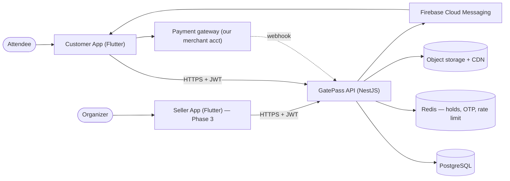
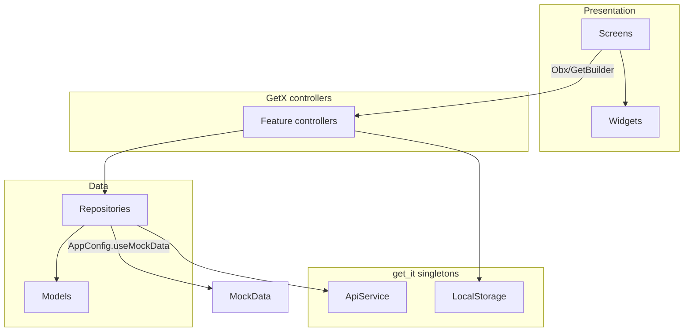
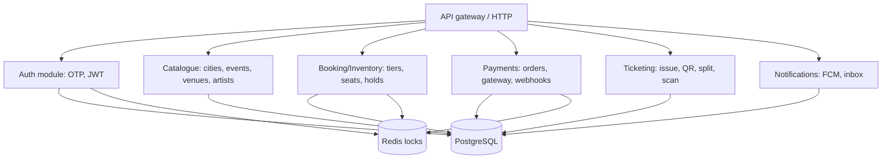

# 3. Architecture — GatePass

## 3.1 System context



## 3.2 Client architecture (feature-first + layers)



- **Screens** render state and dispatch intent to controllers.
- **Controllers** (GetX) hold UI state + orchestrate repositories.
- **Repositories** own one domain each, call `ApiService`, map JSON → models, and fall back to `MockData` while `AppConfig.useMockData` is true.
- **Core services** (`ApiService`, `LocalStorage`) are get_it singletons, injected via `core/di.dart`.

## 3.3 Project structure (as scaffolded)

```
newapp/
  pubspec.yaml · analysis_options.yaml
  lib/
    main.dart                 # init storage/DI, run GatePassApp
    app/
      app.dart                # GetMaterialApp: theme + routes
      theme.dart              # design system (colors, radius, spacing, ThemeData)
      routes.dart             # named routes + GetPage list
    core/
      constants.dart          # AppConfig, Endpoints, StorageKeys
      di.dart                 # setupLocator()
    services/
      network/api_service.dart   # typed HTTP client, ApiResult<T>
      storage/local_storage.dart # Hive wrapper (+ TODO: secure token)
    data/
      models/models.dart         # UserModel, EventModel, TicketModel …
      repositories/              # auth_repository.dart, event_repository.dart …
      mock_data.dart             # sample data for pre-backend UI
    features/
      splash/      splash_screen.dart
      auth/        intro_screen.dart, login_screen.dart, otp_screen.dart
      home/        home_shell.dart, home_screen.dart, event_details_screen.dart
      tickets/     my_tickets_screen.dart
      profile/     profile_screen.dart
      controllers/ auth_controller.dart, home_controller.dart
    widgets/       primary_button.dart, app_text_field.dart, event_card.dart
```

New features follow the same shape: `features/<name>/` for screens, a controller in `features/controllers/` (or a local `controllers/` subfolder as it grows), a repository in `data/repositories/`, and models in `data/models/`.

## 3.4 Conventions
- **Naming:** files `snake_case.dart`; classes `PascalCase`; one public widget/controller per file.
- **State:** `GetxController` + `Rx`/`Obx`; no business logic in widgets.
- **Errors:** repositories return `ApiResult<T>` (never throw to the UI); controllers surface a message.
- **Config:** nothing environment-specific hardcoded; use `AppConfig` + `--dart-define`.
- **Security:** auth token via secure storage (TODO in `LocalStorage`); no secrets in the client; server enforces authz.
- **Theming:** only use tokens from `theme.dart` (`AppColors`, `AppRadius`, `AppSpacing`).

## 3.5 Backend architecture (recommended modules)


## 3.6 Deployment (target)
```mermaid
flowchart LR
  Dev --> CI[CI: lint/test/build]
  CI --> Play[Play Console (App Signing)]
  CI --> Reg[Container registry]
  Reg --> Cloud[Cloud run/k8s: API]
  Cloud --> DB[(Postgres)] & R[(Redis)] & OBJ[(S3+CDN)]
```

## 3.7 Open architecture decisions
- GetX vs Riverpod/Bloc long-term (starting GetX).
- Monolith-first backend vs modular services (recommend modular monolith first).
- REST only vs add GraphQL later.

## 3.8 Worked data-flow trace — "load home"
1. `HomeShell` builds; `HomeController.onInit()` reads `selected_city` from `LocalStorage` and calls `load()`.
2. `load()` sets `loading=true`, calls `EventRepository.highlights(cityId)`.
3. Repo: if `AppConfig.useMockData` → returns `MockData` after a short delay; else `ApiService.request(Endpoints.highlights, query:{cityId})`.
4. `ApiService` builds the URL, adds `Authorization`/`platform` headers, `GET`, 30s timeout, returns `ApiResult`.
5. Repo maps JSON → `List<EventModel>` (or `ApiResult.fail`).
6. Controller: on ok → `events.assignAll(...)`, `loading=false`; on fail → `error.value = msg`.
7. `home_screen` `Obx` renders loading/loaded/empty/error from controller state.

## 3.9 Error propagation (one path, no exceptions to UI)
`ApiService` catches all transport errors → `ApiResult.fail`. Repositories return `ApiResult` unchanged or mapped. Controllers translate `ApiResult.error` into a user string + state flag. Widgets only read state. A `401` is intercepted centrally (add an auth interceptor / check in `ApiService`) → clears token and routes to `/login`.

## 3.10 Testing strategy
- **Repositories:** unit-test both `useMockData` and live paths (mock `http.Client`); assert JSON mapping and error envelopes.
- **Controllers:** test state transitions (loading→loaded/error) with a fake repository.
- **Widgets:** golden tests for `EventCard`, `PrimaryButton`; widget tests for each screen's four states.
- **Backend:** controller/service unit tests + integration against a test Postgres; contract tests asserting responses match `docs/08`.
- **E2E (later):** a scripted discover→book→ticket run against staging.

## 3.11 Adding a backend module (NestJS shape)
```
src/<domain>/
  <domain>.module.ts      # providers + controller
  <domain>.controller.ts  # routes exactly per docs/08
  <domain>.service.ts     # business logic + authz + DB
  dto/*.ts                # class-validator request/response DTOs
  entities/*.ts           # ORM entities mirroring schema.sql
```
Every mutating endpoint: validate DTO → check authz (object-level) → transaction → return the §8.2 envelope. Register Swagger so `/docs` stays the live contract.
