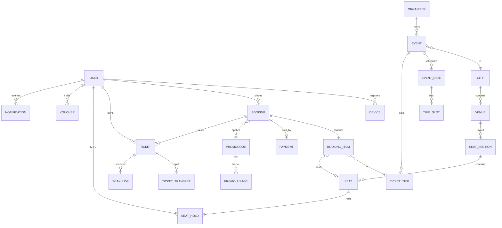

# 4. Database Schema — Eventa (PostgreSQL, our design)

> A clean relational model for the new backend. MVP tables are marked ✅; the rest are Phase 2+. Money is stored as integer **paise** (`*_paise`) to avoid float errors. All tables carry `id uuid pk default gen_random_uuid()`, `created_at`, `updated_at`; soft-delete via `deleted_at` where noted.

## 4.1 ERD (core)



## 4.2 MVP tables

**users** ✅ — `phone unique`, `name`, `email`, `dob`, `gender`, `city_id fk`, `accepted_terms bool`, `terms_version`, `deleted_at`.

**otp_requests** ✅ — `phone`, `code_hash`, `expires_at`, `attempts int`, `verified_at`. (Or store in Redis with TTL.)

**auth_tokens** ✅ — `user_id fk`, `refresh_token_hash`, `expires_at`, `revoked_at`. (Access JWT is stateless.)

**devices** ✅ — `user_id fk`, `fcm_token`, `platform`, `app_version`, `last_seen_at`.

**cities** ✅ — `name`, `state`, `lat`, `lng`, `icon_url`, `is_active`.

**organizers** — `name`, `contact`, `kyc_status`, `payout_account_ref`.

**venues** ✅ — `city_id fk`, `name`, `address`, `lat`, `lng`, `directions_url`, `image_url`, `has_seat_map bool`.

**events** ✅
| col | type |
|---|---|
| organizer_id | fk nullable (MVP can be platform-owned) |
| slug | text unique |
| title, description | text |
| category, genre, language | text |
| card_image_url, banner_url, video_url | text |
| city_id | fk |
| status | enum(draft, live, coming_soon, sold_out, completed) |
| start_date, end_date | timestamptz |
| price_from_paise | int (denormalized for lists) |
| terms, disclaimers | text |
| max_per_user, max_seats_per_booking | int |

**event_dates** ✅ — `event_id fk`, `venue_id fk`, `starts_at`. **time_slots** — `event_date_id fk`, `starts_at`, `ends_at`.

**ticket_tiers** ✅ — `event_id fk`, `event_date_id fk nullable`, `name`, `type`, `price_paise`, `quantity`, `sold`, `min_qty`, `entry_per_ticket int`, `requires_form bool`, flags; (price phases → separate `price_phases` in Phase 2).

**bookings** ✅
| col | type |
|---|---|
| code | text unique |
| user_id, event_id, event_date_id | fk |
| base_paise, discount_paise, fee_paise, tax_paise, total_paise | int |
| promo_id | fk nullable |
| status | enum(pending, confirmed, failed, cancelled) |
| order_ref | text (gateway order id) |

**booking_items** ✅ — `booking_id fk`, `ticket_tier_id fk`, `seat_id fk nullable`, `qty`, `unit_price_paise`.

**payments** ✅ — `booking_id fk`, `gateway`, `txn_id unique`, `amount_paise`, `status`, `raw_response jsonb`, verified_at. (Idempotent on `txn_id`.)

**tickets** ✅ — `booking_id fk`, `owner_user_id fk`, `qr_token text unique`, `status enum(active,transferred,claimed_back,scanned,expired)`, `entries_used int`, `entries_total int`.

## 4.3 Phase 2+ tables
- **seat_sections / seats / seat_holds** — `seat_holds(hold_token unique, user_id, seat_ids[], expires_at, status)`; **exclusion constraint** so a seat can't be double-held/booked.
- **promocodes / promo_usages** — type, discount, min order, caps, validity; `promo_usages(promo_id,user_id)` for per-user limits.
- **fee_config / commissions** — per event/organizer.
- **forms / form_fields / form_responses** — dynamic registration.
- **ticket_transfers** — split/claim-back; invalidate old QR on transfer.
- **scan_logs** — `ticket_id, scanned_by, gate, scanned_at, result` (seller app).
- **vouchers / voucher_shares**, **notifications**, **banners**, **artists / event_artists**, **approval_requests**.

## 4.4 Key constraints / indexes
- `users(phone)` unique; `events(slug)` unique; `bookings(code)` unique; `tickets(qr_token)` unique; `payments(txn_id)` unique.
- `seat_holds`: TTL sweeper on `expires_at`; unique active hold per `(event_date_id, seat_id)`.
- `promo_usages(promo_id, user_id)`; `notifications(user_id, is_read, created_at desc)`.
- FKs `on delete restrict` for financial rows; `cascade` only for pure children (e.g. gallery).

## 4.5 On-device storage (client)
| Store | Contents | Security |
|---|---|---|
| secure storage | auth token | Keystore-backed (required) |
| Hive box | selected city, onboarding flag, cached light profile | non-sensitive |
| image/file cache | event media, invoices | app-private |

## 4.6 Open data decisions
- Postgres vs managed alternative; multi-currency (likely INR only at launch); audit-log strategy for payments.

## 4.7 MVP DDL (ready to run)
Full `CREATE TABLE` statements with types, enums, FKs and constraints live in [`newapp/backend/schema.sql`](../backend/schema.sql) — run it on a fresh Postgres DB. It covers: `cities, users, devices, auth_tokens, organizers, venues, events, event_dates, ticket_tiers, bookings, booking_items, payments, tickets`.

### Server-authoritative price computation
```
base_paise  = Σ (tier.price_paise × item.qty)
discount    = 0 in MVP (promos are Phase 2)
fee_paise   = fee_config.type == 'fixed' ? value × total_qty
                                          : round(base_paise × percent / 100)
tax_paise   = round((base_paise − discount + fee_paise) × gst_percent / 100)
total_paise = base_paise − discount + fee_paise + tax_paise
```
These are computed on the server in `book-ticket`; the client's numbers are never trusted (see API spec §8.9).

### Seat-hold integrity (Phase 2 — design now)
Redis: `SET hold:{eventDateId}:{seatId} {userId} NX EX {ttl}`. On booking confirm, within one DB transaction move the seat to `booked`; a sweeper clears expired holds. A Postgres partial unique index enforces one active booked row per seat, so a race cannot double-sell.
