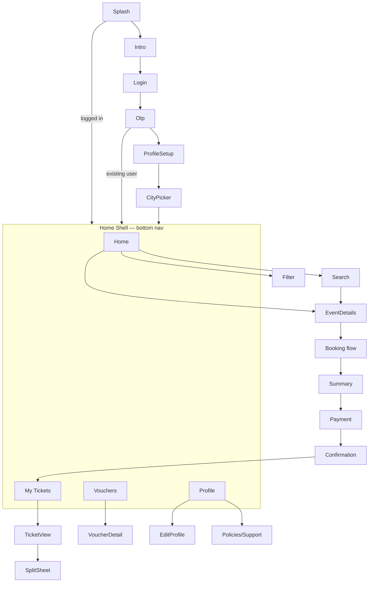

# 5. Screens Inventory — GatePass (customer app)

> Complete screen list with purpose, key states, and phase. Route constants live in `lib/app/routes.dart`. "State" covers the loading/empty/error variants each screen must handle.

## 5.1 Navigation map

## 5.2 Screen list

| # | Screen | Route | Purpose | Key states | Phase |
|---|---|---|---|---|---|
| 1 | Splash | `/` | init, decide intro vs home | loading | ✅ MVP |
| 2 | Intro / onboarding | `/intro` | 3-slide value prop | — | ✅ |
| 3 | Login (phone) | `/login` | enter phone | idle, submitting, error | ✅ |
| 4 | OTP verify | `/otp` | enter code | idle, verifying, error, resend | ✅ |
| 5 | Profile setup | `/profile-setup` | name/DOB/gender, accept terms | validation | ✅ (first login) |
| 6 | City picker | `/city` | detect/choose city | loading, list, search | ✅ |
| 7 | Home shell | `/home` | bottom-nav container | — | ✅ |
| 8 | Home | tab | highlights, trending, categories | loading, loaded, empty, error | ✅ |
| 9 | Search | `/search` | query + results | idle, results, empty | ✅ (basic) |
| 10 | Filter | `/filter` | genre/price/date/lang | — | ⬜ P2 |
| 11 | Event details | `/event` | full event + CTA | loading, loaded, error | ✅ |
| 12 | Image/gallery viewer | `/gallery` | fullscreen media | — | ⬜ P2 |
| 13 | Select venue | `/book/venue` | multi-venue pick | — | ⬜ P2 |
| 14 | Select date/time | `/book/datetime` | date + slot | — | ⬜ P2 |
| 15 | Select tickets | `/book/tickets` | tiers + qty | — | ✅ (GA only in MVP) |
| 16 | Select seats | `/book/seats` | seat map + hold timer | hold-active, expiring, released | ⬜ P2 |
| 17 | Registration form | `/book/form` | dynamic fields | validation | ⬜ P2 |
| 18 | Apply promo | `/book/promo` | enter/list codes | valid, invalid | ⬜ P2 |
| 19 | Summary | `/book/summary` | price breakdown | — | ✅ |
| 20 | Payment | `/book/pay` | gateway checkout | processing, success, failed | ✅ (P2 for real gateway) |
| 21 | Confirmation | `/book/done` | success + animation | — | ✅ |
| 22 | My tickets | tab | upcoming/history | loading, list, empty | ✅ |
| 23 | Ticket view | `/ticket` | QR, details, invoice | active, scanned, expired | ✅ |
| 24 | Split ticket | sheet | transfer units | — | ⬜ P2 |
| 25 | Vouchers | tab | my vouchers | list, empty | ⬜ P2 |
| 26 | Voucher detail | `/voucher` | redeem/share | — | ⬜ P2 |
| 27 | Notifications | `/notifications` | inbox | list, empty | ⬜ P2 |
| 28 | Profile | tab | account menu | — | ✅ |
| 29 | Edit profile | sheet | update fields | — | ✅ |
| 30 | Policies / support | `/web` | T&C, privacy, help | — | ✅ |
| 31 | App update gate | `/update` | force/soft update | — | ⬜ P2 |

**MVP screens: 1–9, 11, 15, 19–23, 28–30** (plus 5–6 on first login). ~17 screens for a shippable thin slice.

## 5.3 Global UI components (`lib/widgets/`)
- `PrimaryButton`, `AppTextField`, `EventCard`, section header, loader/empty/error placeholders, QR view, bottom-sheet scaffold, price-row.
- All themed via `theme.dart` tokens; dark mode supported from day one.

## 5.4 Empty/error/loading policy
Every data screen implements four states: **loading** (skeleton/spinner), **loaded**, **empty** (friendly CTA), **error** (retry). Repositories never throw to the UI (`ApiResult`), so screens always have a message to show.

## 5.5 Detailed MVP screen specs

Each spec: **route**, **data in**, **widgets/layout**, **interactions**, **states**, **done-when**.

### Login — `/login`
- **Data in:** none.
- **Layout:** top brand mark; H1 "Enter your number"; country-code chip `+91` + 10-digit `AppTextField` (number keyboard, maxLength 10); `PrimaryButton` "Send code" (disabled until 10 digits); fine-print terms link.
- **Interactions:** tap Send → `AuthController.sendOtp(phone)` → on ok `Get.toNamed('/otp', arguments: phone)`.
- **States:** idle · submitting (button spinner, field locked) · error (inline red helper from `ApiResult.error`).
- **Done when:** valid phone routes to OTP; invalid shows field error; back exits app from here.

### OTP — `/otp`
- **Data in:** `phone` (route arg).
- **Layout:** H1 "Verify", subtitle "Code sent to +91 •••• ••{last2}"; `pin_code_fields` (6 boxes); resend row with countdown (`resendAfterSec`); `PrimaryButton` "Verify".
- **Interactions:** auto-submit on 6th digit; Verify → `AuthController.verify(phone, code)`; Resend (enabled after countdown) → `sendOtp`.
- **States:** idle · verifying · error (`attemptsLeft`) · resend-cooldown.
- **Done when:** correct code → if `isNewUser` go `/profile-setup` else `/home`; wrong shows attempts-left; after 5 fails → lock + "try later".

### Profile setup — `/profile-setup`
- **Data in:** authenticated user.
- **Layout:** name field; DOB date-picker (max = today−13y); gender segmented control; terms checkbox + version; Continue.
- **Interactions:** Continue → `PUT api/user`; then `/city` if no city else `/home`.
- **Validation:** name ≥ 2 chars; terms required; age ≥ 13.
- **Done when:** profile saved; cannot continue if invalid.

### City picker — `/city`
- **Data in:** `GET api/city/cities`.
- **Layout:** search field; "Use my location" button (geolocation permission → reverse geocode → match city); list of cities with icons.
- **Interactions:** select → persist `selected_city` (Hive) → `/home` (replace); location flow falls back to manual on deny.
- **States:** loading · list · search-empty · permission-denied.

### Home — tab in `/home`
- **Data in:** `GET api/home/highlights?cityId=`.
- **Layout:** app bar with city selector + search icon + notifications icon; banners `carousel_slider` + `smooth_page_indicator`; category chips (horizontal); one `ListView` section per `sections[]` with a header and horizontal `EventCard` rail.
- **Interactions:** city tap → `/city`; search → `/search`; card tap → `/event?slug=`; pull-to-refresh re-fetches.
- **States:** loading (shimmer cards) · loaded · empty ("No events in {city} yet") · error (retry).

### Search — `/search`
- **Layout:** search field (autofocus); results list of `EventCard`.
- **Interactions:** debounce 300 ms → `GET api/events/search?q=`; card → `/event`.
- **States:** idle (recent/empty prompt) · results · no-results.

### Event details — `/event`
- **Data in:** `GET api/event?slug=` (slug from route args/deeplink).
- **Layout:** collapsing hero (`bannerUrl`/`cardImageUrl`); title, genre/lang chips, date + venue rows; description (expandable); gallery strip; FAQ accordion; venue card with "Directions" (opens `directionsUrl`); sticky bottom bar: `priceFrom` + `PrimaryButton` "Book".
- **Interactions:** Book → `/book/tickets` with `eventId`; share → system share of a public URL.
- **States:** loading · loaded · error · (status `sold_out` → disabled CTA "Sold out").

### Select tickets (GA) — `/book/tickets`
- **Data in:** event `tiers[]` (from details or `GET api/booking/tickets`).
- **Layout:** list of tier rows (name, price, remaining) each with a qty stepper; running subtotal pinned at bottom; Continue.
- **Interactions:** stepper bounded by `minQty`, remaining stock, `maxPerUser`; Continue → `/book/summary` with selection.
- **Validation:** at least 1 ticket; respect limits (also re-checked server-side).

### Summary — `/book/summary`
- **Layout:** line items (tier × qty), base, convenience fee, tax/GST, **total**; Pay button.
- **Interactions:** Pay → `POST api/payment/book-ticket` → receive `gatewayToken` → open gateway (`/book/pay`).
- **States:** computing · ready · error (sold-out/limit → back with message).

### Payment — `/book/pay`
- **Interactions:** launch gateway test SDK with `gatewayToken`; on result → `POST api/payment/process-order`.
- **States:** processing (non-cancellable overlay) · success → `/book/done` · failed → retry/back · cancelled → back to summary.

### Confirmation — `/book/done`
- **Layout:** success animation, booking code, "View tickets" → My Tickets tab (clear booking stack).

### My tickets — tab
- **Data in:** `GET api/ticket/my-tickets?scope=`.
- **Layout:** Upcoming/History tabs; ticket cards (event, date, venue, qty, status badge).
- **Interactions:** card → `/ticket`.
- **States:** loading · list · empty ("No tickets yet — explore events").

### Ticket view — `/ticket`
- **Layout:** QR (`qr_flutter` from `qrToken`), event/venue/date, entries used/total, status, "Download invoice" (opens `invoiceUrl`).
- **Offline:** render from cached ticket; QR works without network.

### Profile — tab
- **Layout:** avatar + name/phone; menu: Edit profile, Language, Privacy policy, Terms, Help/Support, Delete account, Logout.
- **Interactions:** Edit → bottom sheet (`PUT api/user`); Delete → confirm dialog → `DELETE api/user` → logout; Logout → clear token → `/login`.

## 5.6 Design tokens (from `lib/app/theme.dart`)
Primary `#6C4DF6`, accent `#FF5C8A`, success `#2BBF7E`; radii 10/16/24; spacing 4/8/16/24/32; cards elevation 0 + 16-radius; buttons 54-high pill-ish 16-radius; light + dark both defined. Reuse tokens only — no inline hex in screens.
