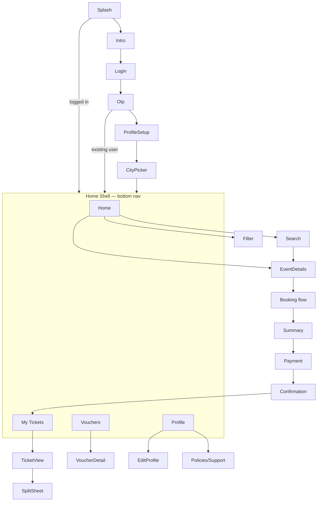

# 5. Screens Inventory — GatePass (customer app)

> Complete screen list with purpose, key states, and phase. Route constants live in `lib/app/routes.dart`. "State" covers the loading/empty/error variants each screen must handle.

## 5.1 Navigation map

## 5.2 Screen list

| # | Screen | Route | Purpose | Key states | Phase |
|---|---|---|---|---|---|
| 1 | Splash | `/` | init, decide intro vs home | loading | ✅ MVP |
| 2 | Intro / onboarding | `/intro` | 3-slide value prop | — | ✅ |
| 3 | Login (phone) | `/login` | enter phone | idle, submitting, error | ✅ |
| 4 | OTP verify | `/otp` | enter code | idle, verifying, error, resend | ✅ |
| 5 | Profile setup | `/profile-setup` | name/DOB/gender, accept terms | validation | ✅ (first login) |
| 6 | City picker | `/city` | detect/choose city | loading, list, search | ✅ |
| 7 | Home shell | `/home` | bottom-nav container | — | ✅ |
| 8 | Home | tab | highlights, trending, categories | loading, loaded, empty, error | ✅ |
| 9 | Search | `/search` | query + results | idle, results, empty | ✅ (basic) |
| 10 | Filter | `/filter` | genre/price/date/lang | — | ⬜ P2 |
| 11 | Event details | `/event` | full event + CTA | loading, loaded, error | ✅ |
| 12 | Image/gallery viewer | `/gallery` | fullscreen media | — | ⬜ P2 |
| 13 | Select venue | `/book/venue` | multi-venue pick | — | ⬜ P2 |
| 14 | Select date/time | `/book/datetime` | date + slot | — | ⬜ P2 |
| 15 | Select tickets | `/book/tickets` | tiers + qty | — | ✅ (GA only in MVP) |
| 16 | Select seats | `/book/seats` | seat map + hold timer | hold-active, expiring, released | ⬜ P2 |
| 17 | Registration form | `/book/form` | dynamic fields | validation | ⬜ P2 |
| 18 | Apply promo | `/book/promo` | enter/list codes | valid, invalid | ⬜ P2 |
| 19 | Summary | `/book/summary` | price breakdown | — | ✅ |
| 20 | Payment | `/book/pay` | gateway checkout | processing, success, failed | ✅ (P2 for real gateway) |
| 21 | Confirmation | `/book/done` | success + animation | — | ✅ |
| 22 | My tickets | tab | upcoming/history | loading, list, empty | ✅ |
| 23 | Ticket view | `/ticket` | QR, details, invoice | active, scanned, expired | ✅ |
| 24 | Split ticket | sheet | transfer units | — | ⬜ P2 |
| 25 | Vouchers | tab | my vouchers | list, empty | ⬜ P2 |
| 26 | Voucher detail | `/voucher` | redeem/share | — | ⬜ P2 |
| 27 | Notifications | `/notifications` | inbox | list, empty | ⬜ P2 |
| 28 | Profile | tab | account menu | — | ✅ |
| 29 | Edit profile | sheet | update fields | — | ✅ |
| 30 | Policies / support | `/web` | T&C, privacy, help | — | ✅ |
| 31 | App update gate | `/update` | force/soft update | — | ⬜ P2 |

**MVP screens: 1–9, 11, 15, 19–23, 28–30** (plus 5–6 on first login). ~17 screens for a shippable thin slice.

## 5.3 Global UI components (`lib/widgets/`)
Design system v0.9 follows Apple's Human Interface Guidelines (review and rationale: `docs/11-Design-Review.md`; skill in `.claude/skills/apple-design/`).
- **Navigation:** `CupertinoTabBar` (Discover / Tickets / Profile), large-title pages via `largeTitleBar()` (`CupertinoSliverNavigationBar`), `CupertinoSlidingSegmentedControl` for in-page switches (Tickets, Vouchers, Share sheet), Cupertino page transitions with swipe-back on Android and iOS. Icons are `CupertinoIcons`.
- **Lists:** `InsetGroup` (uppercase header, footer) + `GroupRow` (icon, title, value, chevron, destructive) for settings-style screens; `SectionHeader` + `SeeAllButton` for rails.
- **Actions:** `PrimaryButton` (50 pt, filled tint), `SecondaryButton` (tinted), `CheckoutBar` (caption + amount + button), `QtyStepper` (32 pt circles inside 44 pt hit targets).
- **Content:** `EventCard` / `EventArt` (rail height measured from text with `textBlockHeight`), `TicketStub` (notched ticket with perforation — the app's signature shape), `TagPill`, `EventBadgeChip`, `PriceBreakdown`, `SearchFieldButton`, `StateView` (Cupertino spinner / empty / "Try Again").
- **Copy:** title case for buttons and navigation titles; sentence case for body text.

## 5.4 Empty/error/loading policy
Every data screen implements four states: **loading** (skeleton/spinner), **loaded**, **empty** (friendly CTA), **error** (retry). Repositories never throw to the UI (`ApiResult`), so screens always have a message to show.

## 5.5 Detailed MVP screen specs

Each spec: **route**, **data in**, **widgets/layout**, **interactions**, **states**, **done-when**.

### Login — `/login`
- **Data in:** none.
- **Layout:** top brand mark; H1 "Enter your number"; country-code chip `+91` + 10-digit `AppTextField` (number keyboard, maxLength 10); `PrimaryButton` "Send code" (disabled until 10 digits); fine-print terms link.
- **Interactions:** tap Send → `AuthController.sendOtp(phone)` → on ok `Get.toNamed('/otp', arguments: phone)`.
- **States:** idle · submitting (button spinner, field locked) · error (inline red helper from `ApiResult.error`).
- **Done when:** valid phone routes to OTP; invalid shows field error; back exits app from here.

### OTP — `/otp`
- **Data in:** `phone` (route arg).
- **Layout:** H1 "Verify", subtitle "Code sent to +91 •••• ••{last2}"; `pin_code_fields` (6 boxes); resend row with countdown (`resendAfterSec`); `PrimaryButton` "Verify".
- **Interactions:** auto-submit on 6th digit; Verify → `AuthController.verify(phone, code)`; Resend (enabled after countdown) → `sendOtp`.
- **States:** idle · verifying · error (`attemptsLeft`) · resend-cooldown.
- **Done when:** correct code → if `isNewUser` go `/profile-setup` else `/home`; wrong shows attempts-left; after 5 fails → lock + "try later".

### Profile setup — `/profile-setup`
- **Data in:** authenticated user.
- **Layout:** name field; DOB date-picker (max = today−13y); gender segmented control; terms checkbox + version; Continue.
- **Interactions:** Continue → `PUT api/user`; then `/city` if no city else `/home`.
- **Validation:** name ≥ 2 chars; terms required; age ≥ 13.
- **Done when:** profile saved; cannot continue if invalid.

### City picker — `/city`
- **Data in:** `GET api/city/cities`.
- **Layout:** search field; "Use my location" button (geolocation permission → reverse geocode → match city); list of cities with icons.
- **Interactions:** select → persist `selected_city` (Hive) → `/home` (replace); location flow falls back to manual on deny.
- **States:** loading · list · search-empty · permission-denied.

### Home — tab in `/home`
- **Data in:** `GET api/home/highlights?cityId=`.
- **Layout:** app bar with city selector + search icon + notifications icon; banners `carousel_slider` + `smooth_page_indicator`; category chips (horizontal); one `ListView` section per `sections[]` with a header and horizontal `EventCard` rail.
- **Interactions:** city tap → `/city`; search → `/search`; card tap → `/event?slug=`; pull-to-refresh re-fetches.
- **States:** loading (shimmer cards) · loaded · empty ("No events in {city} yet") · error (retry).

### Search — `/search`
- **Layout:** search field (autofocus); results list of `EventCard`.
- **Interactions:** debounce 300 ms → `GET api/events/search?q=`; card → `/event`.
- **States:** idle (recent/empty prompt) · results · no-results.

### Event details — `/event`
- **Data in:** `GET api/event?slug=` (slug from route args/deeplink).
- **Layout:** collapsing hero (`bannerUrl`/`cardImageUrl`); title, genre/lang chips, date + venue rows; description (expandable); gallery strip; FAQ accordion; venue card with "Directions" (opens `directionsUrl`); sticky bottom bar: `priceFrom` + `PrimaryButton` "Book".
- **Interactions:** Book → `/book/tickets` with `eventId`; share → system share of a public URL.
- **States:** loading · loaded · error · (status `sold_out` → disabled CTA "Sold out").

### Select tickets (GA) — `/book/tickets`
- **Data in:** event `tiers[]` (from details or `GET api/booking/tickets`).
- **Layout:** list of tier rows (name, price, remaining) each with a qty stepper; running subtotal pinned at bottom; Continue.
- **Interactions:** stepper bounded by `minQty`, remaining stock, `maxPerUser`; Continue → `/book/summary` with selection.
- **Validation:** at least 1 ticket; respect limits (also re-checked server-side).

### Summary — `/book/summary`
- **Layout:** line items (tier × qty), base, convenience fee, tax/GST, **total**; Pay button.
- **Interactions:** Pay → `POST api/payment/book-ticket` → receive `gatewayToken` → open gateway (`/book/pay`).
- **States:** computing · ready · error (sold-out/limit → back with message).

### Payment — `/book/pay`
- **Interactions:** launch gateway test SDK with `gatewayToken`; on result → `POST api/payment/process-order`.
- **States:** processing (non-cancellable overlay) · success → `/book/done` · failed → retry/back · cancelled → back to summary.

### Confirmation — `/book/done`
- **Layout:** success animation, booking code, "View tickets" → My Tickets tab (clear booking stack).

### My tickets — tab
- **Data in:** `GET api/ticket/my-tickets?scope=`.
- **Layout:** Upcoming/History tabs; ticket cards (event, date, venue, qty, status badge).
- **Interactions:** card → `/ticket`.
- **States:** loading · list · empty ("No tickets yet — explore events").

### Ticket view — `/ticket`
- **Layout:** QR (`qr_flutter` from `qrToken`), event/venue/date, entries used/total, status, "Download invoice" (opens `invoiceUrl`).
- **Offline:** render from cached ticket; QR works without network.

### Profile — tab
- **Layout:** avatar + name/phone; menu: Edit profile, Language, Privacy policy, Terms, Help/Support, Delete account, Logout.
- **Interactions:** Edit → bottom sheet (`PUT api/user`); Delete → confirm dialog → `DELETE api/user` → logout; Logout → clear token → `/login`.

### Event formats (v0.7, legacy B4)
All data screens implement loading / loaded / empty / error-retry.
- **Select date & time** (`SelectSessionScreen`) — multi-show events: venue chips → date chips → time-slot cards (sold-out flags); a "Passes" section lists season passes and bundles. Steps with a single choice are skipped.
- **Bundle** (`BundleScreen`) — one chip row per night; pick one show per night ("Pick N of M nights"); quantity stepper; Continue only when every required night is chosen.
- **Seat map** (`SelectSeatScreen`) — stage (top/bottom), sections with colour dot, price, gate chip, row letters on both sides, aisles as gaps, accessible seats (♿), taken seats greyed; standing areas as a card with "N places left" and a stepper; legend. Continue holds the selection on the server; an app-bar countdown runs while held; a live hold is resumed on return ("We kept your seats"); changing the selection or leaving releases it.
- **Attendee details** (`RegistrationScreen`) — shown after ticket selection when forms apply: per form, one card (booking) or one card per attendee; dynamic fields (text, textarea, number, email, phone, select, radio chips, checkbox / multi-select chips, date, time, file upload) with conditional fields and inline errors (client checks + server `error.fields`).
- **Request tickets** (`RequestTicketScreen`) — from the "Request" button on request-only ticket types: explanation, quantity, the same forms; "Send request" → confirmation → My requests.
- **My requests** (`MyRequestsScreen`, Profile → My requests) — cards with status chip (Pending review / Approved / Rejected / Cancelled / Booked), rejection reason, "Withdraw request" (pending) and "Book now" (approved paid tickets); load more.
- **Share feedback** (`SurveyScreen`) — from the ticket screen once the event has started: questions or a link to the organiser's form; thank-you view with optional CTA / auto-redirect.

### Vouchers (v0.8)
- **My vouchers** (`VouchersScreen`, Profile → My vouchers) — tabs Active / Used / Expired with counts; cards with brand colour strip, logo, benefit, "N of M left", validity, NEW badge, "With your tickets" for complimentary ones; pull to refresh, load more; empty/error states per tab.
- **Voucher** (`VoucherDetailScreen`) — brand header, benefit, units left, validity, min order / max discount; QR (refreshes each time it's opened) and reference; coupon code with copy; how to redeem; shared-with list; terms. "Share with a friend" → sheet with number (contact picker), optional name and units.

### Notifications & push (v0.8)
- Inbox items open their screen on tap (My tickets, My requests, voucher, event page). Push taps do the same, including the push that launched the app.
- A push that arrives while the app is open shows as a snackbar with **View**.
- Android 13+ asks for notification permission the first time Home opens after sign-in.

### Web view (v0.8)
- **Web view** (`WebViewScreen`) — for web-only events ("Book on organiser's site") and web links the app can't open itself: progress bar, reload, error-retry; only http/https pages load.

### Organiser console (web, v0.8)
- `/organiser` (OTP sign-in, organiser/admin accounts): events table → event page with status buttons (Publish / Unpublish / Postpone / Cancel with a message to holders), details form, sales cards (tickets, revenue, online, box office, complimentary, checked in, requests waiting), attendee report download, ticket types (inline price / quantity / on-sale edits + add), shows (add / hide), complimentary & box-office issuing, and the requests queue (approve / reject with reason). Light and dark follow the system.

## 5.6 Design tokens — "Utsav" (design direction H, Nov 2026)
The customer app wears the **Utsav** brand: ivory paper, deep peacock teal and saffron, a serif display face, like a premium printed programme. The tokens live in `lib/app/theme.dart` (`UtsavPalette`, `UtsavArt`, `GatePassTheme`) on top of the shared `packages/gatepass_ui` system. The Organiser app keeps the neutral default palette.

| Token | Light | Dark ("Utsav night") |
|---|---|---|
| canvas (paper) / groupedCanvas | #FAF6ED / #F3EBDE | #0E1513 / #0A100F |
| cell | #FFFFFF | #18211F |
| label (ink) / secondary / tertiary | #1D1A15 / #696258 / #8F877A | #F6F0E4 / #B9B0A2 / #8A8277 |
| tint / tintFill (peacock teal) | #0B4E56 / #0B4E56 | #6CC6C0 / #0F6670 |
| accent (saffron) / accentText (ochre) / accentSoft | #DF891C / #965404 / #FBE9CF | #E99A2E / #F0B55A / #3A2A12 |
| success / warning / danger | #1F7A3A / #B43C00 / #C4251C | #4CD77A / #FFA94D / #FF6B5E |

All text pairs meet WCAG AA (4.5:1) on canvas, grouped canvas and cells; tertiary is decorative only. Never put white text on saffron (2.7:1); use ink on saffron or marigold.

**Type.** Display: **Fraunces** SemiBold (headlines, event titles, big dates, prices, section titles). Body: **Inter** (400–700; tabular figures for money and counts). Both are bundled in the shared design package (SIL OFL, `packages/gatepass_ui/assets/fonts/`, static weights subset to Latin + ₹) and used by both apps. `context.serif(size)` for one-off serif numerals; `context.eyebrow` for the letter-spaced ochre line ("THE PROGRAMME · WEEK 47").

**Ornament.** The **jaali** lattice (`JaaliPainter`/`JaaliPanel`) only on ticket headers and hero art. Events without a picture get generated **arch art** (`ArchArt`: an arch under a crescent over the lattice, colours varied per event). Collection cards use the art inks: teal, marigold, maroon.

**Signature screens** (match the direction PDF):
- *Discover:* city pin, round search + bell; eyebrow + "Good evening, Asha." (name in teal italic); Editor's Choice card with a date block; Collections cards; "Coming up" list with big serif dates; Trending rail; Artists.
- *Event:* full-bleed art with round paper buttons; eyebrow (genre · seated · age); serif title; date/venue card with duration and underlined Directions; "The programme" timeline; "Seating & prices" cards; bottom bar "From ₹…" + Select Seats / Get Tickets.
- *Seat map:* title + event line; saffron hold-timer pill; teal stage arc; section dot, name and "₹ · Gate"; 32 pt seats (available outlined in section colour, yours teal with a check, taken beige); legend; "2 seats · D4, D5" with the total.
- *Ticket:* paper ticket with a teal jaali header and crescent; Section / Row / Seat; QR on white; "ADMIT n · Enter by Gate · x of n checked in"; tear line; Booking code and Paid; Send to a Friend + Directions. Screen brightness goes to full while it's open.

Radii 8/12/16 (ticket 22); spacing 4/8/16/24/32; buttons 54 pt with radius 14. Motion stays short and respects Reduce Motion.
