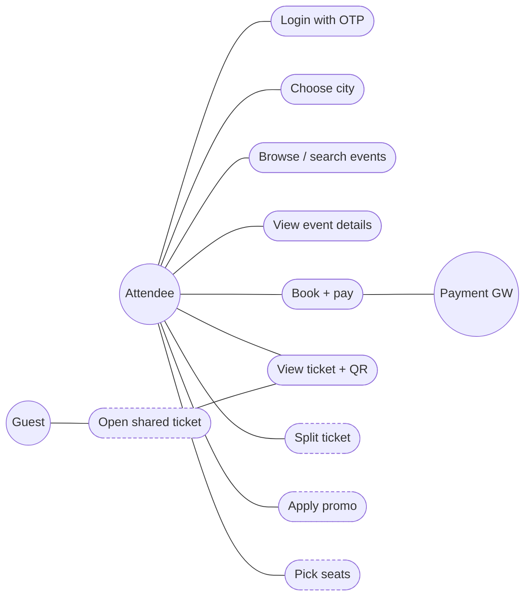
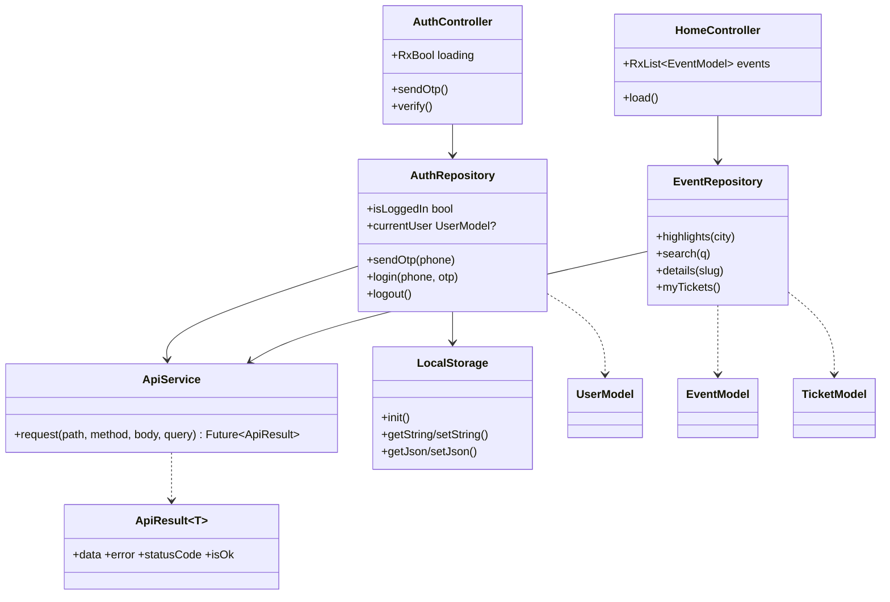
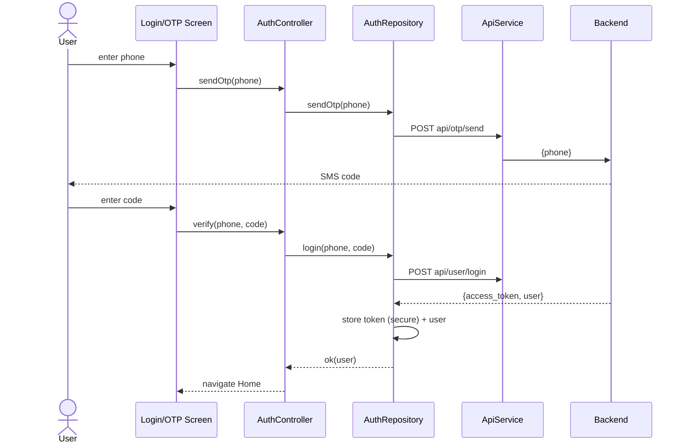
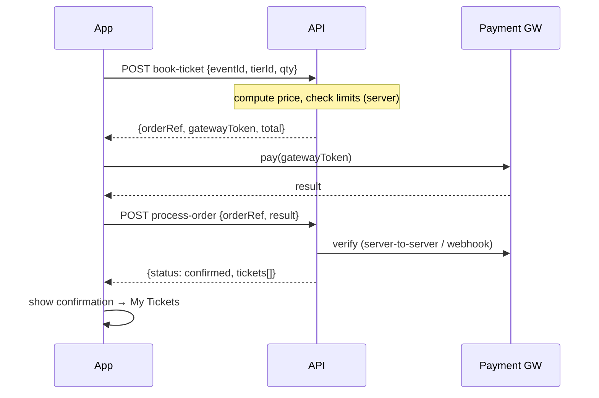
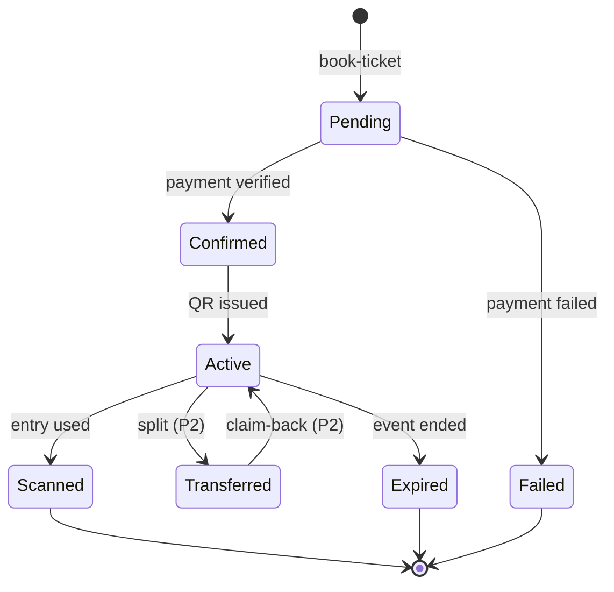
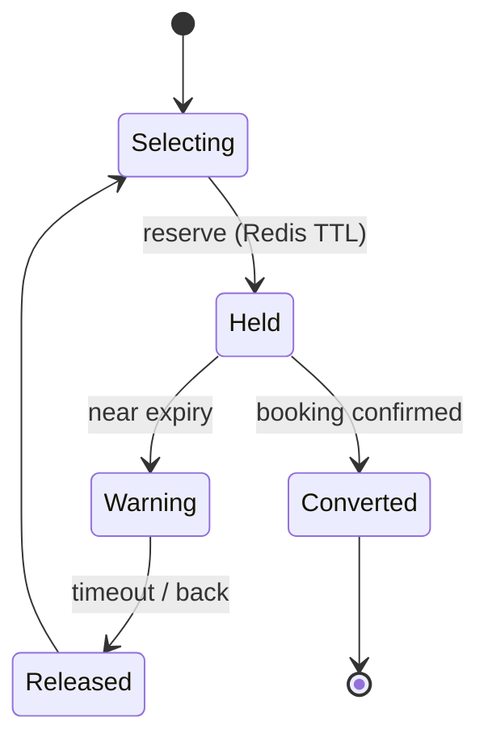
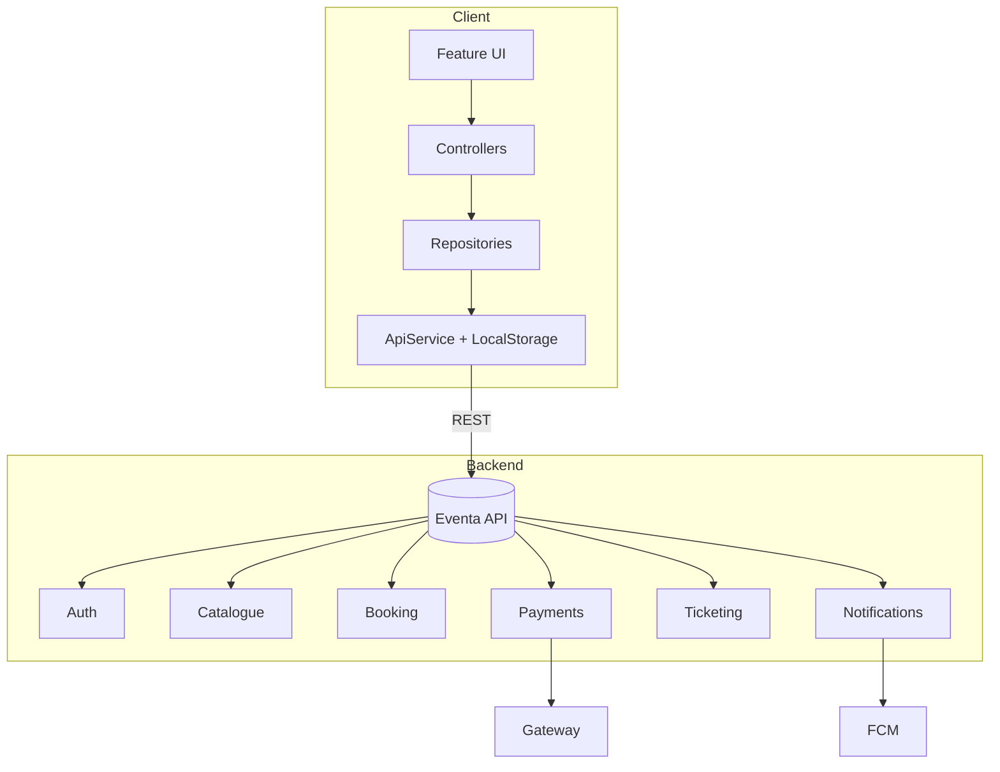

# 6. UML Diagrams — Eventa

## 6.1 Use-case (customer, MVP shaded by phase)

## 6.2 Client class model (core)

## 6.3 Sequence — OTP login

## 6.4 Sequence — book + pay (MVP GA)

## 6.5 State — ticket lifecycle

## 6.6 Seat hold (Phase 2)

## 6.7 Component view

