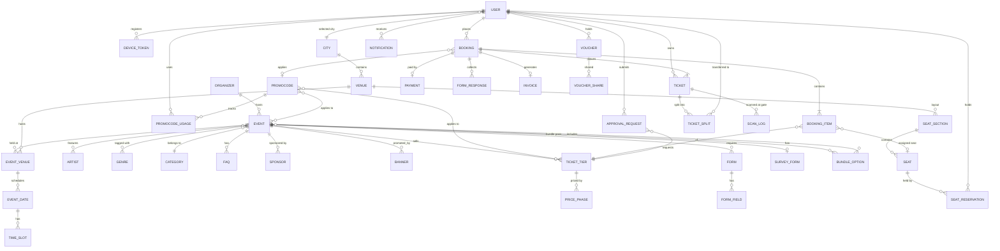

# 3. Database Schema — Showmates Platform

> **Important:** The APKs contain no server database. The server schema below is a **logical data model reconstructed (inferred)** from the client's request/response models and JSON field names found in the Dart AOT snapshot. Field names marked **bold** were observed verbatim. Types, keys and cardinalities are inferred. The on-device storage in §3.4 is observed.

## 3.1 Entity-relationship diagram (logical, inferred)

## 3.2 Table definitions (logical, inferred)

### Identity

**`users`**
| Column | Type | Notes |
|---|---|---|
| id (**userId**) | UUID/ObjectId PK | |
| **phone** / **mobile** | varchar(15) UNIQUE | login identity (OTP) |
| **firstName**, **lastName**, **fullName** / **userName** | varchar | |
| **email** / **emailAddress** | varchar NULL | validated with `emailRegex` |
| **dob** | date | collected at onboarding |
| **gender** | enum | |
| **userCity** / selectedCity → `cities.id` | FK | |
| **preferred_language** | varchar | |
| **acceptedTerms**, **termsVersion** | bool, varchar | consent versioning |
| created_at, updated_at, deleted_at | timestamptz | soft delete for account deletion *(inferred)* |

**`otp_requests`** *(inferred)*: id, phone, otp_hash, expires_at, attempts, verified_at.

**`auth_tokens` / sessions** *(inferred)*: id, user_id, **access_token** (JWT), **refresh_token**, expires_at, revoked_at.

**`device_tokens`**: id, user_id FK, **deviceToken** (FCM), platform, app_version, device_info, updated_at.

**`organizers` / `vendors`**: id (**vendorId**), name, contact, bank/KYC *(web portal)*, status.

### Catalogue

**`cities`**: id, **cityName** / `city_name`, **state** / `state_name`, **cityIcon**, **latitude**, **longitude**, is_active.

**`venues`**: id (**venueId**), city_id FK, **venueName**, **venueAddress**, **theaterAddress**, **pincode**, **latitude**, **longitude**, **venueDirectionLink**, **venueImage**, **hasSeatMap** bool, layout_image.

**`categories`**: id, name, **categoryColor**, **cardCategory**. **`genres`**: id, name.

**`events`**
| Column | Notes |
|---|---|
| id (**eventId**), **eventCode**, **eventSlug** UNIQUE | |
| organizer_id FK (**vendorId**) | |
| **eventTitle** / **title**, **description**, **htmlFormatTitle** | |
| category_id FK, **genre**, **language** | |
| **eventCardImage**, **bannerImage(s)**, **mobileImage**, **mobilecardImage**, **eventVideo** | media |
| **eventStatus** / **status** | draft, live, coming_soon, sold_out, completed *(inferred values)* |
| **startDate**, **endDate**, **seasonStartDate**, **seasonEndDate** | |
| **eventPriceLabel**, **displayStrikePrice** | |
| **termsAndConditions**, **disclaimers**, **guide** | |
| **maxRequestsPerUser**, **maxSeatsPerBooking**, **minPurchaseTickets** | limits |
| **eventPurchaseLimitBannerMessage** | |
| **bookingFlow**, **entry_mode**, **entryPerTicket**, **bookingPerTicket** | flow config |
| **splitLimitEnabled**, **maxSplitTransfers** | |
| **promoted**, **bundleStatus**, **nightHoldingEvent** | flags |

**`event_artists`**: event_id, artist_id. **`artists`**: id (**artistId**), **artistCode**, name, image, bio, **artistOccupationList**.

**`event_venues`**: id, event_id, venue_id. **`event_dates`**: id (**eventDateId**), event_venue_id, **eventDate**, **eventDateTime**. **`time_slots`**: id (**timeSlotId**), event_date_id, start/end time.

**`faqs`**: id, event_id, question, answer, sort. **`sponsors`**: id, event_id, name, logo, **sponsor**, `associate_sponsor` category (**prettySponsorCategory**). **`banners`**: id, city_id, event_id, image, **mobilebanners**, **bannerVideo**, **bannerTitle**, sort, active window.

### Pricing and inventory

**`ticket_tiers`** (`ticket_tiers` / **ticketTiers**)
| Column | Notes |
|---|---|
| id (**ticketId** / **masterTicketId** / **masterEventTicketId**) | |
| event_id, event_date_id, time_slot_id, **sectionId** | scope |
| **ticketName**, **ticketType**, **ticketCategory** (**seatCategoryColor**) | |
| **price**, **basePrice**, **originalPrice**, **strikePrice** | |
| **quantity**, **ticketsSold**, **minQuantity** | inventory |
| **entryPerTicket**, **free_ticket_approval**, **tickets_with_registration**, **survey_only** | behaviour flags |
| **bulkDiscount**, **buyQuantity** | offers |
| **phaseOrder**, **phaseStatus**, **phaseStartDate**, **phaseEndDate**, **autoLiveByPhase**, **priceChangeType**, **priceUpdatedAt** | price phases (could be a separate `price_phases` table) |
| **formIds** | linked registration forms |

**`bundle_options`**: id (**bundleOptionId**), event_id (master), **bundlePass**, **bundleNightsSchedule** JSON, price, included_event_ids.

**`seat_sections`**: id (**sectionId**), venue_id, **sectionName**, **seatSectionName**, ordering, geometry.
**`seats`**: id (**seatId**), section_id, row, column (**columnIndex**), **seatLabel**, status (available, held, booked, blocked), ticket_tier_id.
**`seat_reservations`**: id, **reservationToken** UNIQUE, user_id, event_date_id, time_slot_id, **seatIds**[], expires_at (= now + **holdDurationMinutes**), status (held, released, converted).

### Promotions and fees

**`promocodes`**: id (**promocodeId**), **promocode** UNIQUE, **promocodeType** (public, private, auto), **discountType** (flat, percent), **discountValue**, **maxDiscountAmount**, **minOrderValue**, **minPurchaseAmount**, **usageLimitPerUser**, **maxUsageLimit**, **offerStartDate**, **offerEndDate**, **totalUsageOfPromocodes**, scope (**eventPromocodes**, **ticketPromocodes**).
**`promocode_usages`** (**promocodeUsagesByUser**): promocode_id, user_id, booking_id, used_at.
**`commissions` / fee_config**: id, event_id/organizer_id, **feeType** (`fixed_per_ticket`, percent), **feeValue**, **convenienceFee**, **gstPercentage**, **taxPercent**, **baseCommission**.

### Transactions

**`bookings`**
| Column | Notes |
|---|---|
| id (**bookingId**), **bookingCode** UNIQUE | |
| user_id, event_id, event_date_id, time_slot_id, venue_id | |
| **reservationToken** | from seat hold |
| **appliedPromocodes**, **discountLabel** | |
| **baseAmount**, discount, **convenienceFee**, tax, **totalCommission**, **totalPrice**, **payableAmount** | money (use paise integers) |
| **bookingStatus** | pending, confirmed, failed, cancelled |
| **orderId** / **order_id**, **orderStatus** | gateway order |
| **payment_source** | easebuzz, phonepe, free |
| created_at | |

**`booking_items`**: id, booking_id, ticket_tier_id, seat_id NULL, **quantity**, unit_price, **bundleSelections** JSON.

**`payments`**: id, booking_id, gateway, **txnid**, **transactionId**, **access_key**, **hash** (gateway hash), **net_amount_debit**, status, **payment_response** JSON (raw callback), `udf1..udf10`, **surl** / **furl**, created_at.

**`invoices`**: id, booking_id, invoice_no, pdf_url, gst breakdown.

**`form_definitions`** (**formId**, **formVersion**) / **`form_fields`** (type: text, textarea, select, radio, checkbox, date, time, file; required; options) / **`form_responses`** (booking_id, field_id, value, file_url).

**`survey_forms` / `survey_responses`**: event_id, user_id, answers JSON.

### Fulfilment

**`tickets`**
| Column | Notes |
|---|---|
| id (**ticketId**), booking_id, owner user_id | |
| **qrCode** / **ticketQrCode** / **qrPayload** | signed or opaque QR token |
| **ticketStatus** | active, transferred, claimed_back, scanned |
| **claimStatus** / **claimedStatus** / `claimed_back` | |
| scan state: `fully_scanned`, `partially_scanned`, **entry** count | |
| **splitCount**, **splitAvailableCount**, **remainingSplitTransfers**, **currentSplitDepth** | |
| **masterTicketIds** | parent linkage for split children |

**`ticket_splits`**: id, ticket_id, **splitBy** / **splitByUserId**, recipient phone, recipient user_id, units, **splitLink**, status, claimed_back_at.

**`scan_logs`** *(vendor portal; inferred)*: id, ticket_id, scanned_by (staff), gate, scanned_at, result.

**`approval_requests`**: id, user_id, event_id, ticket_tier_id, **requestedTickets**, form answers, status (pending, **approved**, rejected), decided_by.

**`vouchers`**: id, user_id, **voucherRef**, **redeemCode**, **canRedeem**, **redeemedAt**, units, **canSplit**, **allUnitsShared**, **voucherAccent**, validity.
**`voucher_shares`**: id, voucher_id, **sharedWith**, units, **sharedAt**.

**`notifications`**: id (**notificationId**), user_id, title, body, type, payload JSON (deep-link target), is_read, created_at.

**`short_urls` / deep_links**: id, **shortHash**, target_type, target_id, created_at.

**`app_config`**: platform, **latestVersion**, force_update, message, maintenance.

## 3.3 Suggested indexes and constraints *(recommended)*

- `users(phone)` UNIQUE. `events(eventSlug)` UNIQUE. `bookings(bookingCode)` UNIQUE. `tickets(qrCode)` UNIQUE.
- `seats(event_date_id, seat_id)`: an exclusion constraint so a seat cannot have two active holds or bookings at once.
- `seat_reservations(expires_at)` for the expiry sweeper.
- `payments(txnid)` UNIQUE, so webhook processing is idempotent.
- `promocode_usages(promocode_id, user_id)` for per-user limits.
- `notifications(user_id, is_read, created_at DESC)`.

## 3.4 On-device storage (observed)

### Customer app

| Store | Library | Contents (from observed keys) | Encrypted? |
|---|---|---|---|
| Hive box(es) | `hive` / `hive_flutter` (`initHive`, `openBox`, `local_storage.dart`) | **user_data**, **user_token** / **accessToken**, **selectedCity**, onboarding flags, **deviceToken** | **No.** No `HiveAesCipher` or `encryptionCipher` reference found |
| SharedPreferences | `shared_preferences_android` | small flags and settings | No (plain XML) |
| SQLite | `sqflite` (via `flutter_cache_manager`) | image cache index (`cacheObject`, `cacheKey`) | No |
| File cache | `flutter_cache_manager`, `just_audio_cache`, Lottie cache | images, media | No |
| Downloads | `path_provider`, `open_file`, FileProvider | invoices and ticket PDFs | App-private / shared via FileProvider |

`android:allowBackup="true"` is set on the customer app, so Hive files (including the bearer token) can be included in Android cloud or device backups. See the Security doc, finding S-03.

### Vendor app

| Store | Contents |
|---|---|
| WebView storage (`AndroidLocalStorage`, `AndroidSessionStorage`, cookies) | Seller portal session (cookies/JWT) managed by the web app |
| Firebase Installations | FCM ID |

`allowBackup` is not declared in the vendor manifest, so it defaults to `true` on API < 31.
