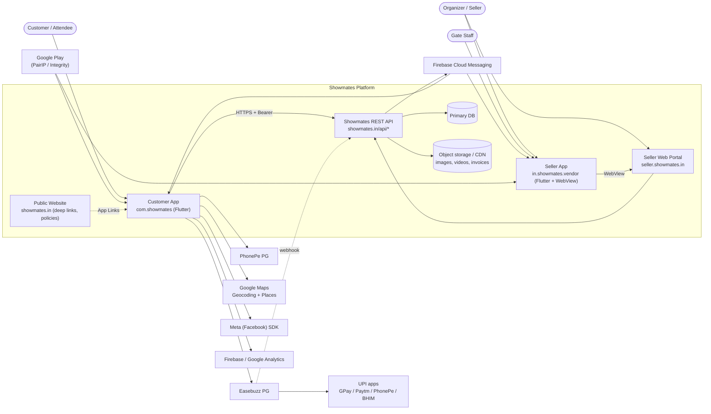
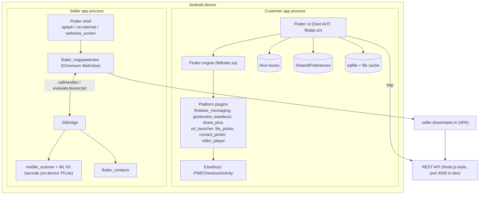
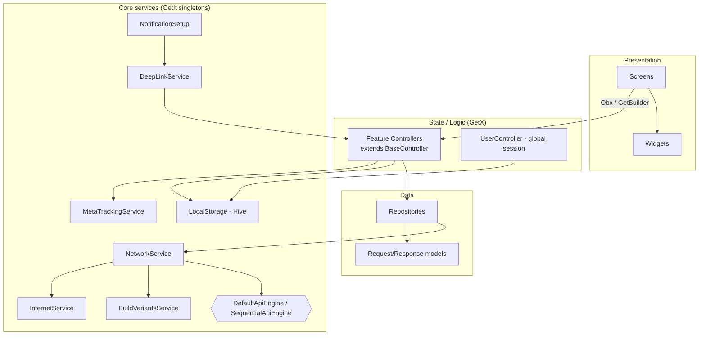
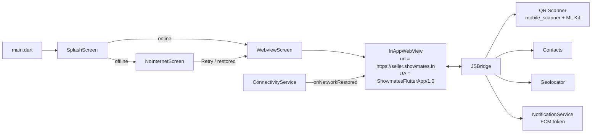
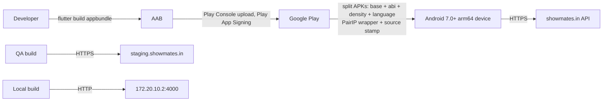

# 4. Architecture — Showmates Platform

## 4.1 System context (C4 level 1)



## 4.2 Container view (C4 level 2)



**Backend stack** *(inferred)*:
- The dev URL `http://172.20.10.2:4000/` and REST naming (`api/…`, kebab-case) point to a **Node.js (Express/Nest) API**.
- The server tech, DB engine (MongoDB vs PostgreSQL) and hosting **cannot be confirmed** from the client.
- ID fields such as `eventId`/`masterTicketId` with camelCase JSON fit either engine.

## 4.3 Customer app: client architecture

The app follows a **feature-first layered architecture** with GetX controllers and a repository pattern:

```
lib/
├── main.dart                         # bootstrap: Firebase, Hive, GetIt, notifications, GetMaterialApp
├── controllers/                      # global: BaseController, UserController
├── features/<feature>/
│   ├── controllers/src/*_controller.dart     # GetX controllers (state + business logic)
│   ├── repositories/src/*_repository.dart    # API calls via NetworkService
│   ├── models/src/remote/{request,response,general}/*.dart   # DTOs (fromJson/toJson)
│   ├── screens/src/*_screen.dart             # pages (routes)
│   ├── widgets/src/*.dart                    # feature widgets
│   └── utils/                                # pure logic (ticket_offer_calculator, bundle_night_assignment)
├── models/general/user_data_response.dart
├── notifications/                    # FCM setup, payload model, action_by_type router
├── resources/                        # constants, routes, validations, extensions, location_service
├── services/
│   ├── network/                      # ApiService, DefaultApiEngine, SequentialApiEngine,
│   │                                 # BuildVariantsService, Encryption, InternetService, dialogs
│   ├── local_storage/                # Hive wrapper
│   ├── deep_link/                    # DeepLinkService, DeepLinkRouter, ShowmatesUrl
│   ├── tracking/                     # MetaTrackingService, MetaAttributionService, MetaCommercePayload
│   ├── get_it/                       # DI registration
│   ├── localization/                 # Languages, language_en, delegate
│   ├── location/                     # CityNormalizationService
│   ├── device_token/, haptics/, logs/, progress_indicator/, responsiveness/
│   └── app_life_cycle_observer/
└── widgets/                          # shared UI kit (CommonButton, CommonText, CommonScaffold, loaders…)
```

### Layer diagram



### Feature modules (observed)

| Module | Controllers | Repositories | Screens |
|---|---|---|---|
| authentication | Authentication, Intro, Login | Authentication, Intro, Login | Intro, Login, OtpVerification, UserDetails |
| home | Home, HomeUi, Events, Location, Search, BookingNotification | Home, Events, Location, Search, BookingNotification | HomeMain, Home, EventDetails, PopularEvents, Search, SearchV2, Location, Notification, FullImage |
| filter | (uses Events) | — | Filter |
| artist | Artist | Artist | ArtistDetails, EventsByArtist |
| booking | Ticket, Seat, Payment | Booking, Ticket, Seat, Promocodes, Form, Commission, ApprovalRequest, EventSurvey | SelectVenue, SelectDate, SelectDateTime, SelectBundleNights, SelectTicket, SelectSeat, RegistrationForm, RequestTicketsForm, ApplyPromoCode, Summary, Booking, TicketBookingAnimation, PartyPop, EventSurvey |
| my_ticket | MyTicket | MyTicket | MyTicket, TicketHistory, (TicketView) |
| voucher | Voucher | Voucher | MyVouchers, VoucherDetail |
| profile | Profile | Profile | Profile |
| config | Update | Update | Update |
| splash / web_view | — | — | Splash, ShowmatesWebView |

### Networking design (observed names)

- `NetworkService` is a facade over an `ApiService` interface with two engines:
  - `DefaultApiEngine`: concurrent requests.
  - `SequentialApiEngine`: a FIFO `QueueItem` queue, for order-sensitive calls such as seat reserve, book and process-order *(inferred)*.
- `Request`, `ApiModel`, `MultipartFileData` (file uploads for dynamic form fields) and `ApiProgressIndicator` (global loader).
- `InternetService` checks connectivity before requests (`checkInternetIsAvailable`).
- `BuildVariantsService` selects the base URL: prod, staging or local.
- `Encryption` exists in `services/network/src/services/encryption/encryption.dart`. Its algorithm could not be recovered statically. It may hash or encode payloads (`crypto` SHA-256, base64).

## 4.4 Seller app: hybrid architecture



**Design rationale** *(inferred)*: the organizer feature set changes quickly and is form-heavy, so it is shipped as a web SPA. The native shell adds only what the browser cannot do well: fast camera QR scanning, contact access, push and background location.

## 4.5 Third-party integration map

| Integration | Customer | Seller | Notes |
|---|:-:|:-:|---|
| Firebase Core / Messaging / Installations | ✔ | ✔ | Push |
| Firebase / GMS Analytics (AppMeasurement) | ✔ | — | |
| Meta Facebook SDK (App Events, attribution) | ✔ | — | ClientToken in resources |
| Google Play Install Referrer, AdServices (Topics, Attribution, Custom Audience) | ✔ | — | marketing attribution |
| Google Maps Geocoding / Places (REST) | ✔ | — | API keys embedded in Dart |
| Easebuzz Payment Kit | ✔ | — | `PWECheckoutActivity` |
| PhonePe | ✔ (route) | — | `/order/initphonepe` |
| Google ML Kit Barcode | — | ✔ | on-device |
| PairIP (Play automatic integrity protection) | ✔ | ✔ | license check, anti-tamper |

## 4.6 Deployment view


