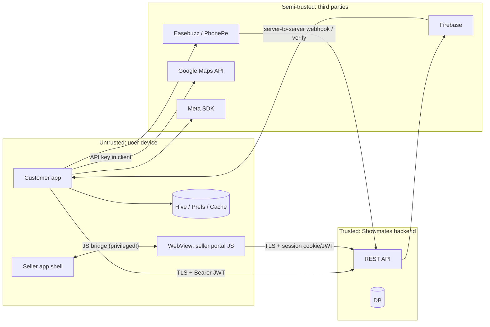
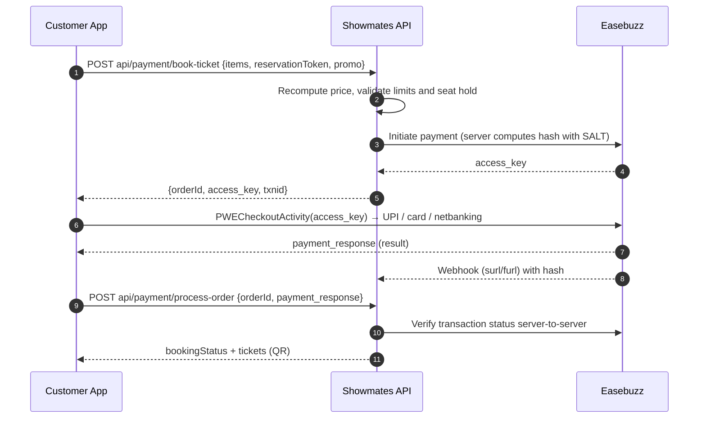

# 5. Security Architecture — Showmates Platform

> This is static analysis only. Findings are based on the shipped artifacts and are labelled **Observed** or **Inferred**. No dynamic testing, traffic interception or server testing was performed. Secrets found in the binary are **partially redacted** here.

## 5.1 Trust boundaries

The most important boundaries:
1. **Device ↔ API.** The client is untrusted, so all pricing, limits and seat locks must be enforced on the server.
2. **Payment gateway ↔ API.** Order confirmation must rely on gateway verification, not on what the client reports.
3. **WebView JS ↔ native bridge** (seller app). Any script running in the WebView can call camera, contacts, location and push-token handlers.

## 5.2 Authentication and session

| Aspect | Observation | Assessment |
|---|---|---|
| Identity | Phone number + OTP (`api/otp/send` → `api/user/login`) | Passwordless. The server must rate-limit OTP sends and verifies *(not verifiable)* |
| Token | `Authorization: Bearer …`, keys `access_token`, `refresh_token`, `id_token`, `user_token`, `verifyToken` | JWT-style bearer *(inferred)* |
| Token storage | Hive box via `local_storage.dart`. **No `HiveAesCipher` / `flutter_secure_storage` found** | ⚠ Plaintext in the app sandbox (S-03) |
| Logout | `api/user/logout` + local clear | OK if the server revokes the token |
| Device binding | FCM `deviceToken` registered after login; `checkDeviceTokenPeriodically` | Good for push. Not an auth factor |
| Seller auth | Inside the web portal (cookies/localStorage in the WebView) | Out of APK scope |
| Account deletion | `delete_account_response` | Meets Play policy |

### Authorisation (server-side requirements, recommended)
- Object-level checks on every `ticketId`, `bookingId`, `voucherId` and `splitByUserId` to prevent IDOR. Split, claim-back, invoice and shared-ticket endpoints are high-risk.
- Promo-code limits (`usageLimitPerUser`, `minOrderValue`) and purchase limits (`maxRequestsPerUser`, `maxSeatsPerBooking`) must be re-checked server-side at `book-ticket`.
- Prices must be recomputed server-side. The client computes discounts (`ticket_offer_calculator.dart`, `calculateTicketDiscount`), so the client total must never be trusted.

## 5.3 Transport security

| Item | Observation |
|---|---|
| Production / staging | `https://showmates.in/`, `https://staging.showmates.in/` |
| Cleartext | No `usesCleartextTraffic` attribute and no `networkSecurityConfig`. targetSdk 36 blocks cleartext by default, **but** the release binary contains `http://172.20.10.2:4000/` (S-02) |
| Certificate pinning | **None observed.** No pin hashes or custom `SecurityContext` were found in app code. Dart `http` ignores the user CA store, which makes casual interception harder, but this is not pinning |
| Payment | Easebuzz SDK over HTTPS (`pay.easebuzz.in`) |

## 5.4 Payment security flow

**Observed:** the client receives `access_key` from the server, and no Easebuzz **salt/key** strings were found in the Dart code. Hash generation therefore appears to be server-side ✔.
**Requirement:** `process-order` must not trust `payment_response` from the client. It must verify with the gateway, or rely only on the signed webhook, and it must be idempotent on `txnid`.

## 5.5 Platform hardening

| Control | Customer | Seller |
|---|---|---|
| APK signing | v2 + v3, Play source stamp ✔ | v2 + v3, Play source stamp ✔ |
| Play Integrity / anti-tamper | PairIP application wrapper + `LicenseActivity` ✔ | ✔ |
| Code obfuscation | Dart identifiers **readable** (class, method and package names visible), so `--obfuscate` does not appear to be used ⚠ | same ⚠ |
| Exported components | `MainActivity` (launcher + deep links), `CustomTabActivity` (fbconnect), FCM receivers (permission-guarded), `ProfileInstallReceiver` (DUMP-guarded) | `MainActivity`, FCM receivers, `ProfileInstallReceiver` |
| FileProviders | 3, all `exported=false`, `grantUriPermissions` ✔ | none |
| Dynamic receivers | `DYNAMIC_RECEIVER_NOT_EXPORTED_PERMISSION` (signature) ✔ | ✔ |
| `allowBackup` | **true** ⚠ | default (true below API 31) ⚠ |
| Legacy storage | `requestLegacyExternalStorage=true` (no effect on API 30+) | — |
| Root / emulator detection | Only via PairIP | Only via PairIP |

### Permissions

| Permission | Customer | Seller | Justification |
|---|:-:|:-:|---|
| INTERNET, ACCESS_NETWORK_STATE | ✔ | ✔ | API |
| ACCESS_FINE / COARSE_LOCATION | ✔ | ✔ | City detection / seller location |
| READ / WRITE_CALENDAR | ✔ | — | Add event to calendar (an intent alone would avoid the permission) |
| POST_NOTIFICATIONS, WAKE_LOCK, VIBRATE, c2dm RECEIVE | ✔ | ✔ | Push |
| CAMERA | — | ✔ | QR scanning |
| READ_CONTACTS | — | ✔ | Contact import (sensitive PII) |
| RECEIVE_BOOT_COMPLETED | — | ✔ | Reschedule notifications |
| AD_ID-related AdServices (Topics, Attribution, Custom Audience), Install Referrer | ✔ | — | Marketing attribution. Needs Data-Safety disclosure |
| GET_PACKAGE_SIZE | ✔ | — | (from an SDK) |
| CHECK_LICENSE | ✔ | ✔ | PairIP |

## 5.6 Findings register

| ID | Severity | App | Finding | Evidence | Recommendation |
|---|---|---|---|---|---|
| **S-01** | **High** | Customer | **Two Google Maps API keys are hardcoded** in the Dart snapshot: `AIzaSyAQr_…yhOOE` and `AIzaSyCR…441Cpo` | `libapp.so` strings next to the Geocoding/Places URLs | Restrict keys to the Android package name + signing SHA-1 and to the Geocoding/Places APIs only, or proxy through the backend. Rotate if unrestricted |
| **S-02** | Medium | Customer | Dev/staging endpoints shipped in production: `http://172.20.10.2:4000/`, `https://staging.showmates.in/`, plus a `BuildVariantsService` / `customBaseUrl` switch | `libapp.so` strings | Strip non-prod config with `--dart-define` flavours. Make sure no runtime URL switch is reachable in release |
| **S-03** | Medium | Customer | Bearer token and user PII (`user_data`: phone, DOB, gender) stored in **unencrypted Hive**, and `allowBackup=true` | No Hive cipher refs; manifest | Use `flutter_secure_storage` (Android Keystore) for tokens, or `HiveAesCipher` with a Keystore-held key. Set `allowBackup=false` or add `dataExtractionRules` |
| **S-04** | Medium | Seller | **Privileged JS bridge** (QR camera, contacts, location, FCM token) is exposed to whatever page the WebView loads | `addJavaScriptHandler`, `JSBridge`, `openQRScanner`, `LaunchContacts` | Allow-list the origin `https://seller.showmates.in` in every handler (check `controller.getUrl()`). Block navigation to other origins with `shouldOverrideUrlLoading`. Enforce a strict CSP on the portal to limit XSS impact |
| **S-05** | Medium | Customer | `MainActivity` has a BROWSABLE intent filter for **any** `http`/`https` URL (no host) as well as verified `showmates.in` links | Manifest lines 55–60 | Remove the host-less filter. Validate all deep-link parameters in `DeepLinkRouter` and resolve only through `api/deep-link/fetch` |
| **S-06** | Low | Customer | Facebook `CodelessDebugLogEnabled=true` in production | Manifest meta-data | Set to false |
| **S-07** | Low | Customer | `device_preview` dev package compiled into release | Dart package URIs | Gate it behind `kDebugMode` or remove the dependency |
| **S-08** | Low | Both | Dart code not obfuscated, so business logic and endpoint names are easy to reverse-engineer | Readable identifiers | Build with `--obfuscate --split-debug-info` |
| **S-09** | Low | Customer | Template package `com.example.showmates.MainActivity` | Manifest | Hygiene. Rename the namespace |
| **S-10** | Info | Both | No TLS certificate pinning | No pinning artefacts | Consider pinning (SPKI) for the API and payment endpoints, with a backup pin and a kill-switch |
| **S-11** | Info | Seller | `STUB_FCM_TOKEN` fallback string | Dart strings | Make sure the server rejects or ignores stub tokens |
| **S-12** | Info | Customer | Large demo images (`demo*.png`, up to 15 MB) shipped | Inventory | Remove unused assets (reduces attack surface and size) |

## 5.7 Server-side controls checklist (recommended for the backend team)

- [ ] OTP: 4–6 digits, at most 5 verify attempts, at most 3 sends per 10 min per phone and per IP/device, expiry under 5 min, hashed at rest.
- [ ] JWT: short-lived access token (≤ 15 min) + rotating refresh token, revocation on logout and account deletion.
- [ ] Object-level authorisation on every ticket, booking, voucher, split and invoice endpoint.
- [ ] Seat hold: atomic lock with TTL = `holdDurationMinutes`. Release on expiry. One active hold per user per event date.
- [ ] Price integrity: recompute the total from the DB at `book-ticket`. Ignore client amounts.
- [ ] Payment: verify by webhook hash and status API. Idempotent on `txnid`. Reconciliation job.
- [ ] QR tickets: opaque random token or HMAC-signed payload (`ticketId|eventDateId|nonce`). Single-use per entry (`entryPerTicket`). Scans validated server-side and logged with staff ID and device ID.
- [ ] Split/transfer: rate limits, `maxSplitTransfers`, invalidate the old QR on transfer or claim-back.
- [ ] PII: DPDP-compliant consent for DOB, gender, location and contacts. Retention and deletion policies.
- [ ] Logging and monitoring: auth anomalies, payment mismatches, scan fraud (duplicate scans across gates).
