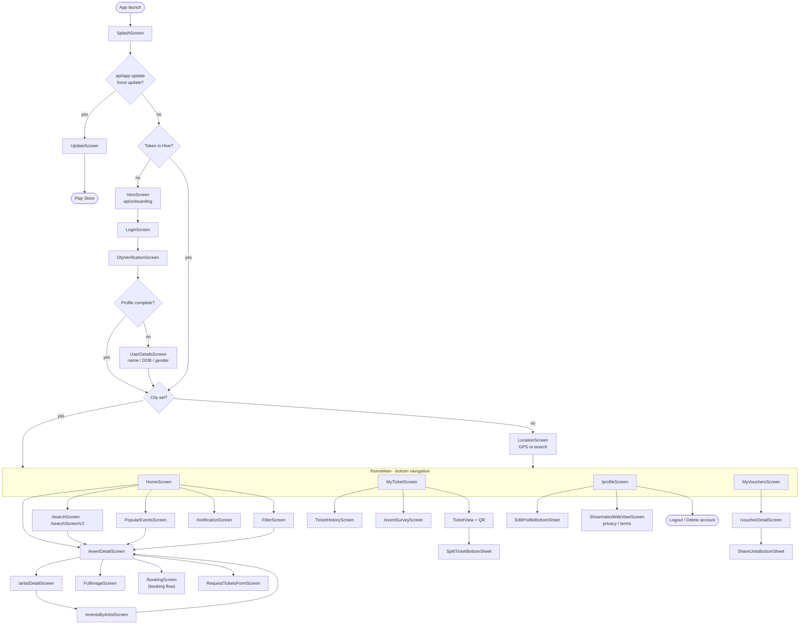
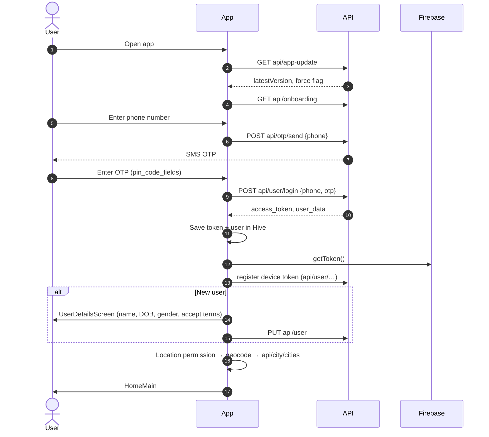
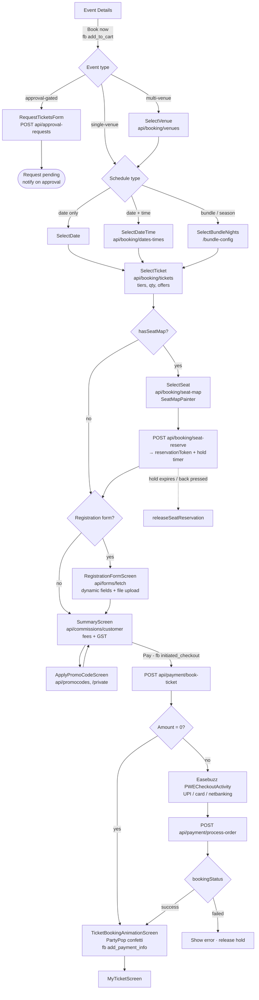
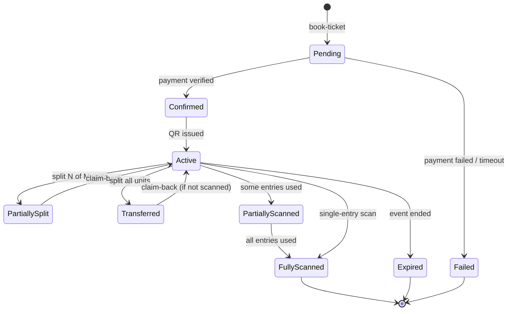
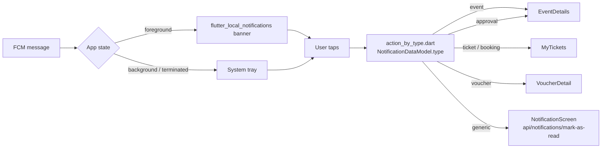
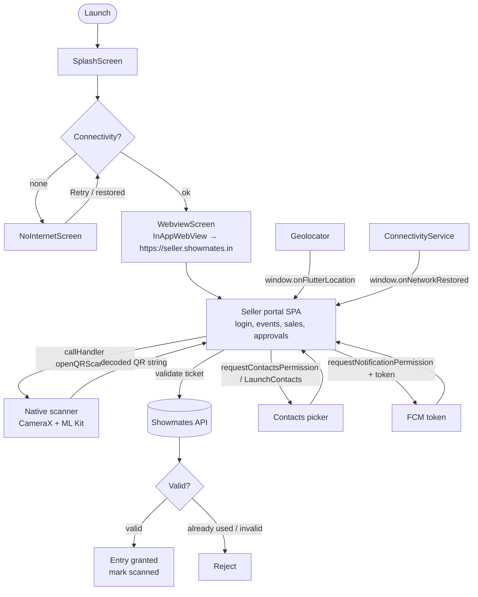
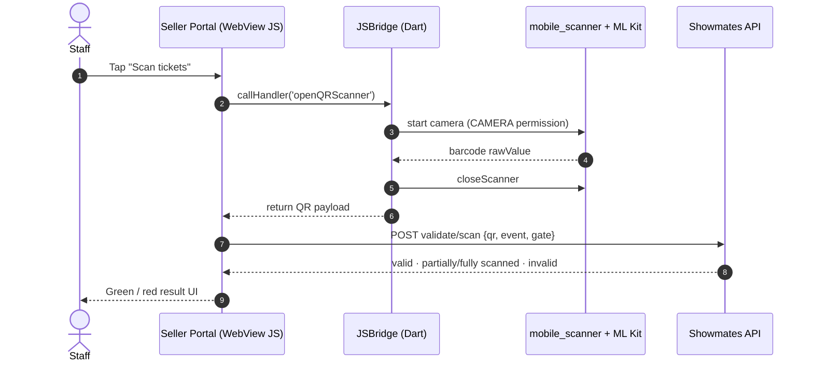

# 6. App Flow — Showmates Platform

> Screen names and routes are **observed** (Dart files and route strings such as `/eventDetailScreen`, `/bookingScreen`). Transition logic is **inferred** from controller and API naming.

## 6.1 Customer app: navigation map

## 6.2 Onboarding and login

## 6.3 Discovery

1. `HomeController` loads `api/home/highlights` (banners, today special, trending) and `api/home/explore` for the selected city.
2. The user taps a category, genre or banner. `EventsController` loads `api/events` with a `ListPageDataRequest` (city, filters, page).
3. Search: as the user types, `api/events/search` returns suggestions. Submitting calls `api/events/search/group-wise`, which returns results grouped by events, artists and venues.
4. Filter: `api/events/filter-options` returns genre, category, language and price options. Results are reloaded with the filters applied.
5. Event detail: `api/event?slug=` returns `DetailsPageDataResponseV2`. Meta `fb_mobile_content_view` is logged.

## 6.4 Booking flow (core)

**Hold timer behaviour (inferred):**
- After `seat-reserve`, a countdown runs for `holdDurationMinutes`.
- At `lockWarningDuration` the user sees a warning.
- When the hold expires, or the user confirms the "should go back?" dialog (`should_go_back_dialog.dart`), the client releases the hold and returns to seat selection.

## 6.5 Ticket lifecycle

### Split and share flow
1. Ticket view → "Split" → `SplitTicketBottomSheet` → choose a count and pick contacts (native contact picker) or type numbers.
2. `POST api/ticket/split` returns a `splitLink`, which is shared via WhatsApp or the share sheet.
3. The recipient opens the `https://showmates.in/…` App Link. `DeepLinkService` calls `api/deep-link/fetch` and then `api/ticket/shared-ticket`. If the recipient is not logged in, they log in first. The ticket then appears in their My Tickets.
4. The sender can call `api/ticket/claim-back` before the ticket is scanned.

## 6.6 Push notification handling

## 6.7 Seller app flow

### Gate scanning sequence

