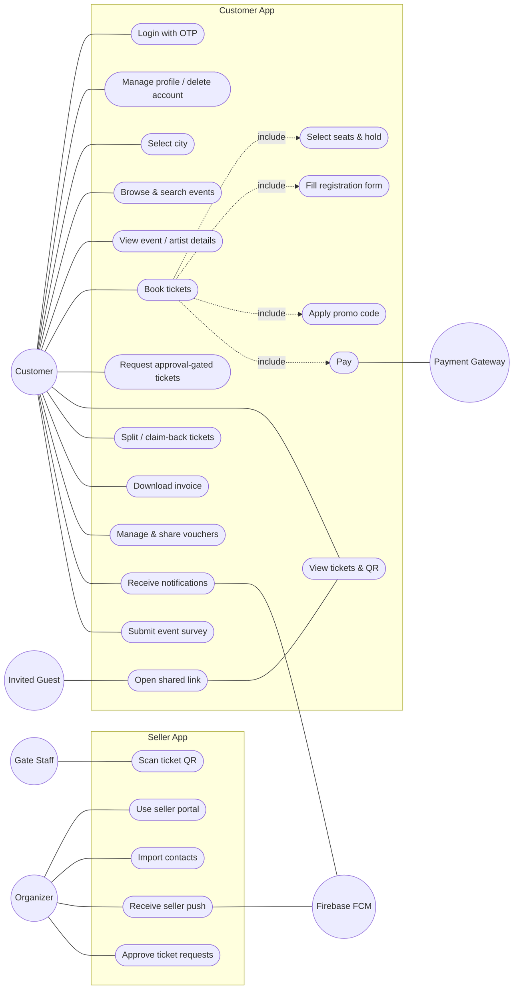
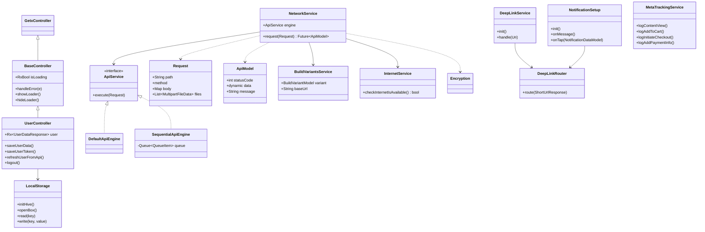
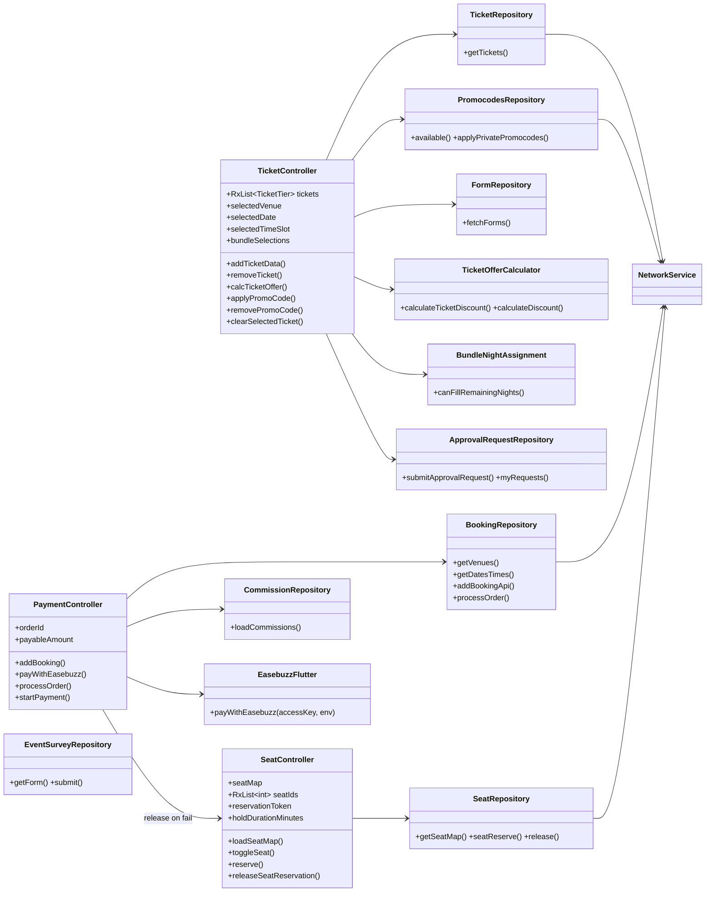
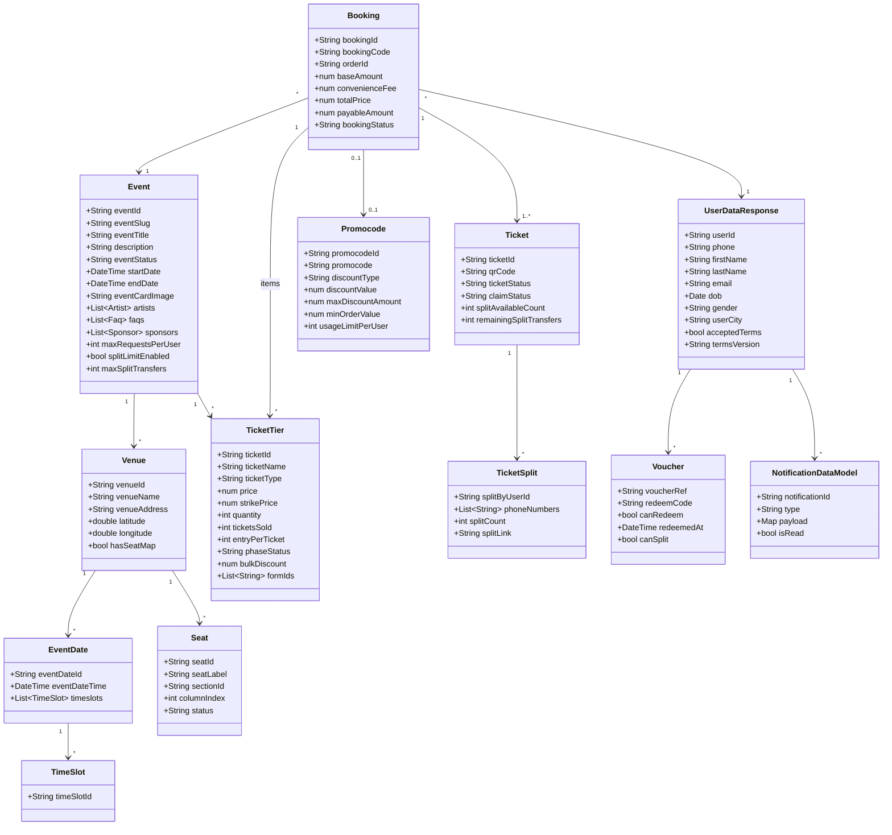
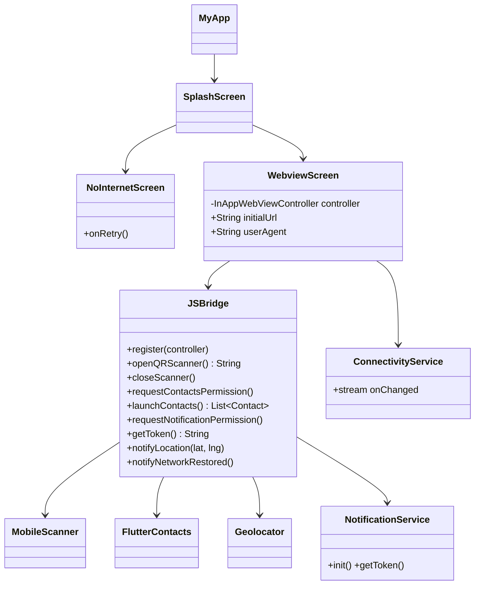
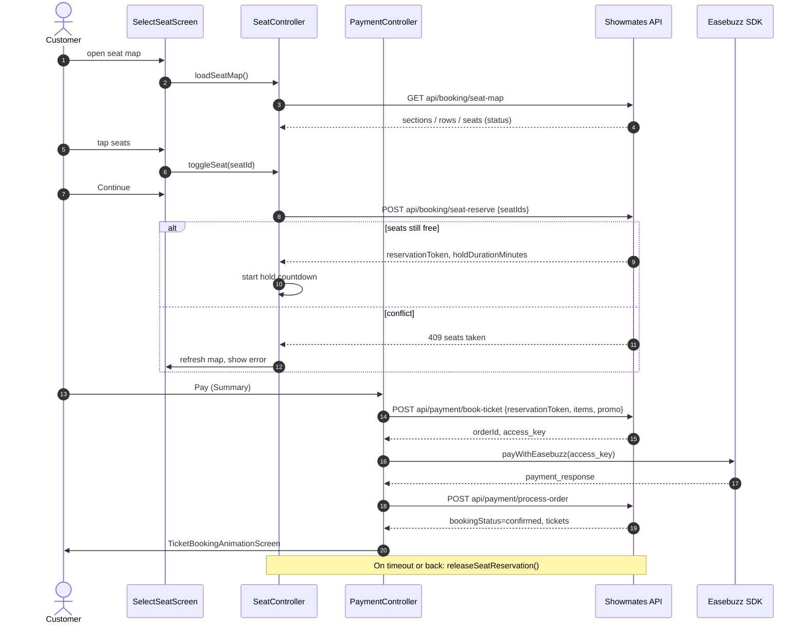
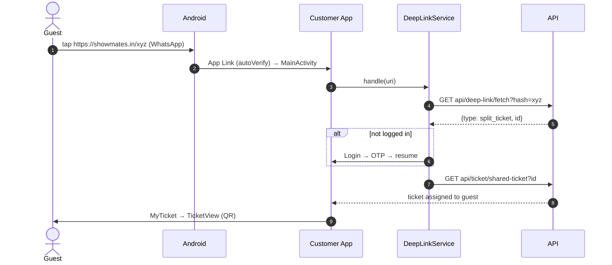
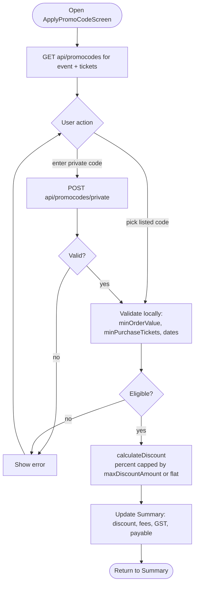
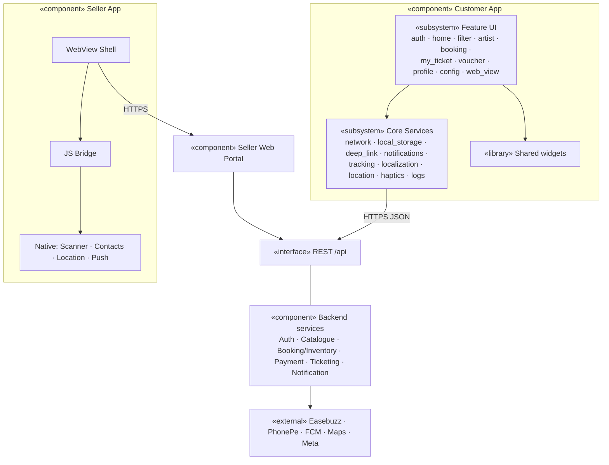
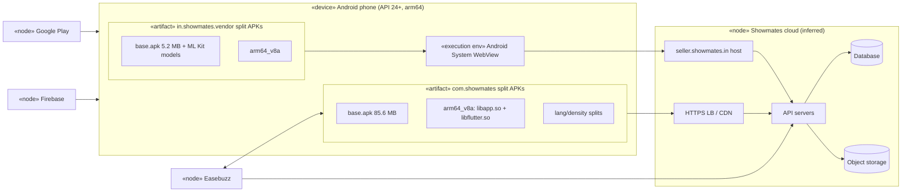

# 7. UML Diagrams — Showmates Platform

> Class and file names are **observed** in the Dart AOT snapshots. Attributes, methods and associations are **inferred** from observed field and method names (for example `payWithEasebuzz`, `releaseSeatReservation`, `splitTicketApi`). Mermaid has no native use-case notation, so use-case diagrams are drawn as flowcharts.

## 7.1 Use-case diagram

## 7.2 Class diagram: customer app core framework

## 7.3 Class diagram: booking feature

## 7.4 Class diagram: domain model (DTOs)

## 7.5 Class diagram: seller app

## 7.6 Sequence: seat selection, hold and payment

## 7.7 Sequence: deep link to shared ticket

## 7.8 Activity diagram: promo-code application

## 7.9 Component diagram

## 7.10 Deployment diagram

